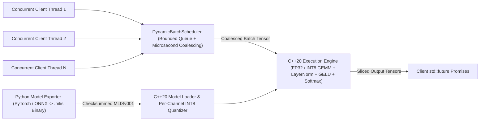

# Technical Architecture — ML Inference Server (`ml-inference-server`)

## 1. System Overview

`ml-inference-server` is a low-latency **C++20 neural network inference engine and dynamic batching scheduler** paired with a **Python PyTorch/ONNX model weight serializer and golden parity verifier**.

## 2. Core Engineering Decisions

1. **Symmetric Per-Output-Channel `INT8` Weight Quantization**:
   - During model load or layer construction, each output channel $o \in [0, D_{\text{out}})$ computes its scale $s_o = \max_i |W_{o,i}| / 127.0$ and quantizes weights to $q_{o,i} = \text{clamp}(\text{round}(W_{o,i} / s_o), -127, 127) \in \text{int8\_t}$.
   - This reduces weight storage by **~3.88x** while preserving post-softmax probability parity within $< 0.015$ maximum absolute difference (`L_inf`).
2. **Checksum-Guarded Binary Model Format (`MLISv001`)**:
   - Weight files begin with an 8-byte magic header (`MLISv001`), layer descriptors (`in_features`, `out_features`, `activation`, `use_layer_norm`), contiguous `float32` parameters, and a trailing 64-bit **FNV-1a checksum**.
   - Truncated files, trailing garbage bytes, out-of-range layer dimensions, or single-bit flips fail closed during `SequentialModel::load`.
3. **Thread-Safe Dynamic Batching with Overload Backpressure**:
   - `DynamicBatchScheduler` coalesces concurrent single-sample and micro-batch requests into a single contiguous `B x D_in` tensor up to `max_batch_size` within a configurable `batch_timeout` window, amortizing weight memory reads across the batch.
   - When queue depth reaches `max_queue_depth`, `submit()` immediately throws `OverloadError` and increments `rejected_overloaded` rather than allowing unbounded queue latency.
