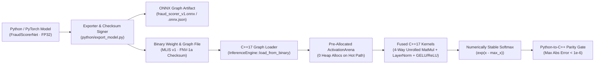

# Technical Architecture (`ml-inference-server`)

## 1. System Overview & Execution Pipeline

`ml-inference-server` bridges Python/PyTorch model authoring and ONNX graph export with a zero-dependency, low-latency **C++17 inference engine**. It eliminates Python interpreter and per-operator heap-allocation overhead on the serving hot path using contiguous row-major tensors, pre-allocated activation arenas, and fused `Linear + Bias + LayerNorm + GELU/ReLU` operator kernels.

---

## 2. Core Components & Invariants

### 2.1 Binary Weight & Graph Format (`MLIS` v1)
- **Header (`16 bytes`, little-endian)**:
  - `magic` (`uint32 = 0x53494C4D`, ASCII `"MLIS"`)
  - `version` (`uint32 = 1`)
  - `num_layers` (`uint32`)
  - `expected_checksum` (`uint32`, rolling 32-bit FNV-1a hash across all layer float32 weight, bias, and LayerNorm parameter buffers)
- **Per-Layer Record**:
  - `in_features` (`uint32`), `out_features` (`uint32`), `has_layer_norm` (`uint32`), `activation_code` (`uint32`: `0=NONE`, `1=RELU`, `2=GELU`)
  - `weights` (`float32[out_features * in_features]`, stored output-major so inner dot products iterate contiguously with stride 1 across `in_features`)
  - `bias` (`float32[out_features]`)
  - Optional `ln_gamma` (`float32[out_features]`) and `ln_beta` (`float32[out_features]`)
- **Tamper & Bit-Rot Protection**: `InferenceEngine::load_from_binary` recomputes the rolling FNV-1a checksum across every parameter buffer during load and throws `std::runtime_error` on any single-bit mismatch.

### 2.2 Pre-Allocated `ActivationArena` (Zero Hot-Path Heap Allocations)
- Standard naive inference allocates new intermediate vectors (`std::vector<float>`) on every layer transition of every request, causing allocator contention and cache misses.
- `ActivationArena` pre-allocates a contiguous float buffer once per worker thread. At the start of each `forward_fused_into` call, `arena.reset()` resets the bump pointer (`offset_ = 0`) in $O(1)$ time without freeing or zeroing memory.

### 2.3 Operator Fusion & Cache Locality
- **Unfused Baseline (`forward_unfused`)**: Executes separate passes over intermediate activation tensors for matrix multiplication, bias addition, LayerNorm, and activation, writing and re-reading intermediate matrices from cache/memory on each step while allocating temporary tensors.
- **Fused Execution (`forward_fused_into`)**: Computes the 4-way loop-unrolled dot product `sum(x[k] * w[o, k]) + bias[o]` and applies elementwise activation (`ReLU` / `GELU`) or row-local `LayerNorm + GELU` while the output row is still hot in L1 data cache.

---

## 3. Numerical Parity Guarantees

- Both the Python reference evaluator (`python/export_model.py`), the PyTorch `torch.nn.Module`, and the C++17 `InferenceEngine` operate in IEEE-754 single-precision `float32` using exact `erf`-based `GELU`:
  $$\text{GELU}(x) = 0.5 \cdot x \cdot \left(1 + \text{erf}\left(\frac{x}{\sqrt{2}}\right)\right)$$
- On the 64-sample golden validation batch (`64 x 4 = 256` output class probabilities), the maximum absolute deviation between Python/PyTorch and C++17 (`tests/test_parity.py`) is verified to be **`< 1e-6`**.
