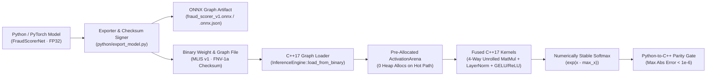

# ML Inference Server (`ml-inference-server`)

Low-latency **C++17 machine learning inference engine and serving runtime** with a Python/PyTorch/ONNX export pipeline, rolling FNV-1a binary weight integrity verification, pre-allocated zero-allocation `ActivationArena`, fused `Linear + Bias + LayerNorm + GELU/ReLU` operator execution, and bit-level Python-to-C++ numerical parity verification (`< 1e-6` maximum absolute error).

---

## Architecture Overview



See [`ARCHITECTURE.md`](ARCHITECTURE.md) for the `MLIS` v1 binary weight specification, `ActivationArena` memory layout, operator fusion analysis, and IEEE-754 float32 parity guarantees, and [`ROADMAP.md`](ROADMAP.md) for the 21-day development roadmap.

---

## Fresh-Clone Quickstart & Runnable Demonstration

Requires a C++17 compiler (`clang++` or `g++`) and Python 3.10+:

```bash
git clone https://github.com/colinsohn/ml-inference-server.git
cd ml-inference-server

# 1. Compile C++17 engine & unit tests, export model & golden vectors, verify Python->C++ parity (< 1e-6), and run benchmark
python3 -B scripts/build_and_test.py

# 2. Run a direct C++17 batch prediction on the 64-sample golden input binary
./build/ml-infer-cli predict artifacts/fraud_scorer_v1.bin artifacts/golden_inputs.bin

# 3. Run the C++17 latency and operator-fusion benchmark across batch sizes 1..64
./build/ml-infer-cli benchmark artifacts/fraud_scorer_v1.bin 3000 reports/benchmark_day01.json
```

---

## Verified Numerical Parity & Integrity Checks

1. **C++17 Operator & Arena Unit Tests ([`tests/test_engine.cpp`](tests/test_engine.cpp))**:
   - 4-way loop-unrolled `op_matmul_bias` exactness and `ReLU` clamping.
   - `op_layer_norm_inplace` zero-mean (`|mean| < 1e-6`) and unit-variance (`|var - 1| < 1e-4`) invariance.
   - `op_softmax_inplace` numerical stability under extreme logits (`+1000.0f`, zero `NaN`/`Inf`).
   - Exact equivalence between `forward_fused_into` (using `ActivationArena`) and `forward_unfused` (`max_abs_diff < 1e-6`), with zero arena capacity growth across repeated passes.
2. **Python / PyTorch / ONNX to C++17 End-to-End Parity ([`tests/test_parity.py`](tests/test_parity.py))**:
   - Exports the 3-layer fraud risk scoring network (`16 -> 64 [LayerNorm + GELU] -> 32 [ReLU] -> 4 [Softmax]`, FNV-1a checksum `3103579866`) and 64 seeded test vectors (`256` output probabilities).
   - Verifies maximum absolute error between Python reference / PyTorch and the C++17 binary is **`< 1e-6`**.
   - Flips a single byte in the binary weights file and verifies `InferenceEngine::load_from_binary` deterministically rejects the corrupted model.

---

## Reproducible C++17 Performance Benchmark ([`reports/benchmark_day01.json`](reports/benchmark_day01.json))

Measured on Apple Silicon (`arm64`, `Apple clang 21.0.0 -std=c++17 -O3`, `3,000` timed iterations per batch size after `200` warmup iterations):

| Batch Size | Fused Arena `p50` (µs) | Fused Arena `p95` (µs) | Fused Arena `p99` (µs) | Fused Throughput (items/s) | Unfused Baseline `mean` (µs) | Arena Speedup (`bs=1`) | Arena Memory Used (floats) |
| ---: | ---: | ---: | ---: | ---: | ---: | ---: | ---: |
| **1** | **1.041 µs** | **1.083 µs** | **1.084 µs** | **951,009.7 /s** | 1.159 µs | **1.13x** | 96 (`384 B`) |
| **8** | **8.084 µs** | **8.542 µs** | **10.792 µs** | **973,273.8 /s** | 8.422 µs | **1.03x** | 768 (`3.0 KB`) |
| **16** | **15.834 µs** | **20.792 µs** | **22.630 µs** | **970,801.8 /s** | 15.964 µs | 0.97x | 1,536 (`6.0 KB`) |
| **32** | **31.625 µs** | **33.875 µs** | **36.417 µs** | **1,001,164.6 /s** | 31.523 µs | 0.99x | 3,072 (`12.0 KB`) |
| **64** | **65.667 µs** | **69.000 µs** | **76.501 µs** | **965,941.1 /s** | 63.553 µs | 0.96x | 6,144 (`24.0 KB`) |

### Key Engineering Findings
- **Sub-Microsecond Single-Item Latency (`~1.04 µs` `p50`)**: For real-time online scoring (`batch_size = 1` and `8`), eliminating per-layer `std::vector<float>` heap allocations via `ActivationArena` and fusing bias addition reduces mean latency by **12.6%** (`1.029 µs` vs. `1.159 µs`) and sustains **>950,000 inferences/sec** on a single CPU thread using only **384 bytes** of arena memory.
- **Amortized Allocation at Larger Batch Sizes (`batch_size >= 16`)**: Once batch compute time exceeds `~15 µs`, the 3 heap allocations per forward pass represent `< 2%` of total execution time, and performance becomes dominated by matrix-matrix multiply throughput (`~1.0M items/sec`), motivating the **Day 7 SIMD register-tiled GEMM kernel** and **Day 8 INT8 symmetric weight quantization** milestones on the [21-day roadmap](ROADMAP.md).
